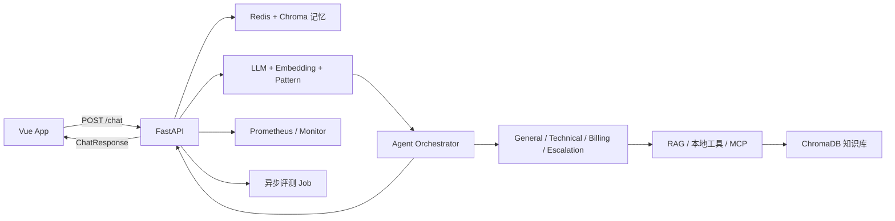

# 01 当前状态审计

## 一句话定位

EchoMind 是一个面向客服场景的全栈 AI Agent 系统：Vue 调试台调用 FastAPI，后端完成记忆读取、三路意图融合、主辅 Agent 路由、RAG/MCP 工具执行、回复合成、记忆提交、评测与监控。

## 当前核心链路

### 后端证据

- `api/main.py`：`/chat`、`/health`、`/monitor`、`/metrics`、知识库、评测、Embedding 和 MCP API。
- `/chat` 已有 50 秒总预算、按会话并发控制、`client_request_id` 幂等回执、安全工具执行前落盘以及 `success/partial/failed` 状态。
- `agents/agent_orchestrator.py`：主/辅 Agent、并行执行、工具白名单、失败回退、在线路由降权与恢复。
- `tooling/tool_manager.py`：查询改写、召回、重排、精确缓存、single-flight、缓存失效和熔断。
- `memory/conversation_memory.py`：Redis 近期记忆/回执/锁和 ChromaDB 情景记忆/画像。
- `evaluation/`：意图与对话质量评测、LLM-as-a-Judge、Few-shot 校准、基线回归和异步 Job。
- `monitor/performance_monitor.py`：Agent/Tool 成功率、延迟、Z-score 异常、Webhook 和路由反馈。
- 后端约 44 个 Python 文件、14 个 `test_*.py`，静态计数约 122 个测试函数；参数化后实际用例数会更多。

### 前端证据

- `src/lib/backends.js`：Python/Java 后端适配、聊天幂等 ID、知识库、监控、评测和 Tool Trace 调用。
- `src/lib/requestState.js`：以 generation/sequence 防止切换后端或连续操作时旧响应覆盖新状态。
- `src/lib/evaluationJobs.js`：评测轮询、临时故障重试、终态处理与恢复任务。
- `src/components/RequestInspector.vue`：意图、检索、路由、生成、工具调用和运行告警展示。
- `src/App.vue`：849 行，承载聊天、知识库、评测和大部分页面状态，是当前前端可维护性的主要热点。

## 已有量化证据（历史材料，不是本次改造成果）

本地 `data/eval/` 的 2026-10-25/2026-11-09 报告显示：

| 指标 | 历史结果 | 正确表述 |
| --- | ---: | --- |
| 重复只读检索模型调用 | 6 → 2，降低 66.7% | 既有精确缓存实验结果 |
| 重复检索耗时 | 10082.5 ms → 2829.8 ms，降低 71.9% | 小批量在线观察，不是统计基准 |
| 七场景输出 Token | 4410 → 3024，降低 31.4% | 回复约束调整后的历史对比 |
| 评测通过 | 8/8 | 既有本地基线 |
| 意图准确率 / Macro-F1 | 90.9% / 0.8333 | 仅 11 条意图样本 |
| 完整性 / 有用性均值 | 0.70 / 0.8286 | Judge 评测，需说明模型与校准版本 |

限制：样本量小、存在 Judge 偏差、模型供应商波动，不能把这些数字直接外推到生产环境。

## 2026-11-13 本次验证记录

| 检查 | 结果 | 说明 |
| --- | --- | --- |
| shushu 后端审计 | 成功 | 生成 `audit/backend/audit.json`、`overview.md`、`overview.html` |
| shushu 前端审计 | 成功 | 生成 `audit/frontend/audit.json`、`overview.md`、`overview.html` |
| 前端单元测试 | 14/14 通过 | `npm test`，耗时约 207 ms |
| 前端构建 | 未通过 | Node 20.17.0 低于 Vite 7 的 20.19+；沙箱不允许向前端目录写临时文件 |
| 后端 pytest | 未进入执行 | 系统 Python 缺少 `anthropic/httpx/fakeredis`；仓库 `.venv` 是 POSIX 布局，不能在当前 Windows 直接使用；收集阶段 11 个模块报错 |
| Docker baseline | 未执行 | 当前命令环境找不到 `docker` |
| 真实模型/存储联调 | 未执行 | 未启动服务，也未发送会产生模型费用的请求 |

因此当前状态是 **local-full-run 预审完成、完整基线未跑通**，不能声称完成了本地全链路运行。

## 优势与面试价值

1. **可靠性比普通 Demo 深**：幂等、会话锁、安全副作用工具回执、部分失败语义都可讲。
2. **Agent 不是只换 Prompt**：角色有 workflow、输入/输出合同、工具域和 handoff 条件。
3. **AI 质量已有起点**：有意图、端到端回复、Judge 校准、回归基线和结果明细。
4. **性能优化已有真实证据**：精确缓存、single-flight、画像更新节流以及 Token/阶段耗时采集。
5. **前端不是静态聊天框**：能展示路由、工具轨迹、监控与评测，并处理请求竞态。

## 主要缺口

| 优先级 | 缺口 | 面试风险 |
| --- | --- | --- |
| P0 | 无可复现的当前环境基线 | 指标、测试和部署容易被追问击穿 |
| P0 | `/chat` 只返回最终结果，无流式 token/阶段事件 | AI 应用体验与实时可解释性不足 |
| P0 | 评测结果缺少统一的 dataset/prompt/model/skill 版本和实验比较 | 不能证明改 Prompt 或模型后为什么可发布 |
| P1 | 仅进程内指标与 Tool Trace，缺少跨网关/HTTP/LLM/存储的 Trace | 排障故事无法形成完整瀑布图 |
| P1 | 没有仓库内 CI Workflow；无覆盖率、lint、类型、依赖/镜像扫描门禁 | 工程化闭环不完整 |
| P1 | 前端测试集中在状态工具，没有组件、契约和 E2E | 前后端联调回归风险高 |
| P1 | 精确缓存已有，但没有受控语义缓存和错误命中安全评测 | 缺少更典型的 AI 性能/成本实验 |
| P2 | `App.vue` 过大；API 模型中存在重复 `BatchDocInput` 定义 | 可维护性问题，适合顺手治理但不是主亮点 |
| P2 | Compose 路径同时考虑 Java 后端，Python+Vue 的最小全栈路径不够独立 | 面试演示可能被无关服务阻塞 |

## 不建议作为主改造

- 单纯“增加 Redis”：Redis 和缓存已经存在。
- 单纯“增加 Prometheus”：已有 `/metrics` 和 Prometheus Compose，应补 Trace、Dashboard、SLO 和告警闭环。
- 单纯“增加测试”：已有大量后端测试，应补 CI 门禁、契约/E2E 和可复现环境。
- 微服务拆分、Kafka、Kubernetes：当前规模没有足够收益，容易被追问为过度设计。
- 只换模型或改 Prompt：没有版本化实验与回归证据时，面试价值很低。

