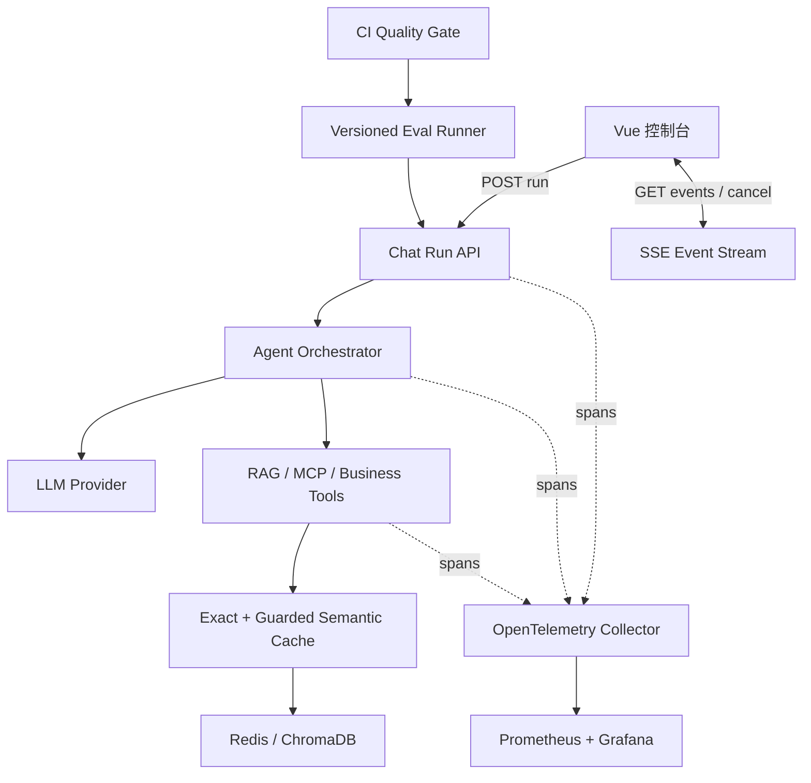

# 02 面试展示改造蓝图

## 内部改造候选排序

| 排名 | 改造包 | 面试价值 | 预计投入 | 风险 | 结论 |
| ---: | --- | --- | --- | --- | --- |
| 1 | 流式对话 + 实时 Agent/Tool 轨迹 | 前后端完整、视觉效果强、可讲并发/幂等/取消 | 2–3 天 | 中 | 必做 |
| 2 | 版本化 AI 评测 + 发布门禁 | 命中 AI 应用工程核心，能证明质量 | 2–3 天 | 中 | 必做 |
| 3 | 安全语义缓存 + 性能/成本实验 | 有算法和工程取舍，可量化 | 2–3 天 | 中高 | 时间允许再做 |
| 4 | OTel + SLO Dashboard | 生产化能力强，但需依附主链路 | 1–2 天 | 中 | 横向贯穿 |
| 5 | RBAC/限流/审计日志 | 实用但 AI 区分度较弱 | 1–2 天 | 低 | 作为补充 |

## 目标架构

## 改造 A：流式对话与实时执行轨迹

### 用户价值

- 首屏不再等待完整回答，先看到“已接收 / 意图识别 / 路由 / 工具调用 / 生成中”。
- 可以取消慢请求；断线后可按 `Last-Event-ID` 恢复，不重复执行有副作用工具。
- 前端展示真实事件，不用根据最终响应猜测执行过程。

### 核心设计

- 使用“创建 Run + SSE 订阅”的两步协议，避免原生 `EventSource` 不能 POST 请求体的问题。
- 事件只暴露脱敏摘要，不把 Prompt、Token、完整工具输出或密钥推到浏览器。
- `run_id` 负责流生命周期，`client_request_id` 继续负责业务幂等，`request_id` 负责全链路追踪。
- 取消是协作式取消：已开始的外部副作用工具不自动重放，保留现有 `tool_outcome_unknown` 语义。

### 演示点

1. 发送“登录报 401，同时多扣了 50 元”。
2. 时间线展示多意图融合、Technical 主 Agent、Billing 辅 Agent、知识库/工具事件。
3. 页面逐步输出回复，并显示 TTFT、总耗时、模型调用和工具耗时。
4. 主动断网/切换后端，恢复时不重复执行。

## 改造 B：AI 评测实验台与发布门禁

### 用户价值

- 每次 Prompt、模型、Skills 或检索参数变化都有可比较的实验记录。
- CI 不依赖“感觉更好”，而是基于确定性断言、质量分、延迟和成本决定是否放行。
- 前端可以筛选失败案例、查看 before/after 和回归原因。

### 核心设计

- `dataset_version`：用例内容哈希 + 人工版本号。
- `system_version`：Git SHA、模型 ID、Prompt hash、Skills hash、检索参数。
- 两层评测：先跑确定性安全/路由/工具断言，再跑 LLM-as-a-Judge；Judge 失败不得默认给分。
- 用 bootstrap 置信区间或至少重复 3 次控制模型波动；小样本报告必须标注区间和样本量。
- PR 使用 mock/确定性小套件；夜间或手动 Workflow 使用真实模型完整套件，控制费用。

### 建议质量门禁（目标阈值）

- 关键安全/副作用用例：100% 通过。
- 意图 Macro-F1：不低于已确认基线 0.8333，且新增困难集后不得下降超过 0.02。
- 对话通过率：不低于对照组 2 个百分点以上的负向差异。
- P95 延迟：相对对照不恶化超过 15%。
- 平均输出 Token：相对对照不恶化超过 10%，除非质量提升有显著证据。

门禁值必须在首个可复现 baseline 后冻结，以上只是设计默认。

## 改造 C：安全语义缓存与成本实验

### 为什么不是普通缓存

项目已经有“相同查询”的精确缓存和 single-flight。新增价值应是：对语义相近、无个性化、只读的 FAQ/RAG 查询复用结果，同时证明不会把相似但关键条件不同的问题错误复用。

### 安全边界

仅缓存满足全部条件的请求：

- 只读、无用户画像依赖、无订单/金额/账号等个性化实体。
- 不调用写工具，不涉及支付、退款执行、权限变更、人工转接。
- 命中同一租户、知识库 revision、检索配置、模型和 Prompt/Skill 版本。
- 相似度超过校准阈值，并通过关键实体/否定词一致性检查。

强制绕过：`client_request_id` 副作用流程、包含敏感实体、低置信度意图、缓存条目过期或评测标记为高风险。

### 实验对照

- A：无缓存。
- B：现有精确缓存。
- C：精确 + 受控语义缓存。
- 指标：命中率、错误命中率、P50/P95、模型调用数、输入/输出 Token、质量/groundedness、内存占用。

## 横向能力

### OpenTelemetry

以 `request_id` 关联 `nginx -> FastAPI -> memory -> intent -> route -> agent -> tool -> Redis/Chroma -> LLM`。Span 只记录阶段、状态、模型、Token、文档 ID 和耗时；用户文本默认不入属性。

### 测试

- 后端单测保留并补流式、取消、重连、语义缓存安全用例。
- 使用 OpenAPI schema 生成/校验前端契约。
- Playwright 覆盖聊天、断线重连、后端切换、知识库导入和评测对比。
- k6/Locust 覆盖 1/10/30 并发及长对话。

### CI/CD

PR：lint/type/unit/contract/frontend build/E2E mock/安全扫描。主分支：镜像构建、SBOM、容器 smoke。定时/手动：真实模型评测与成本预算门禁。

## 分阶段里程碑

| 阶段 | 产物 | 可停止点 |
| --- | --- | --- |
| M0 基线 | 可复现环境、测试、Compose、5 条 demo 请求、baseline 报告 | 能证明原项目可运行 |
| M1 流式链路 | Run/SSE API、前端时间线、取消/重连测试 | 最强视觉演示版本 |
| M2 评测门禁 | 版本 manifest、compare API、前端 diff、CI 小套件 | 最强 AI 工程版本 |
| M3 可观测性 | OTel Trace、SLO Dashboard、告警演练 | 生产化故事完整 |
| M4 语义缓存 | 安全策略、阈值校准、A/B/C 报告 | 有性能/成本实验结果 |

## 完成定义

只有同时满足以下条件，才可以把改造写成“已实现”：

- 一条命令或明确步骤可本地启动。
- 自动化测试和至少一个端到端场景通过。
- 有 before/after 原始报告，而不是手工填写百分比。
- 失败案例、限制和安全边界已记录。
- 7 分钟内能完成现场演示，断网或模型不可用时有录屏/报告兜底。

